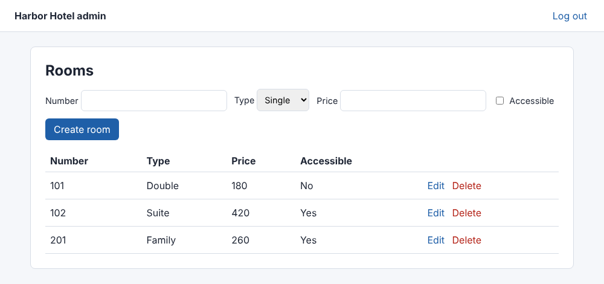
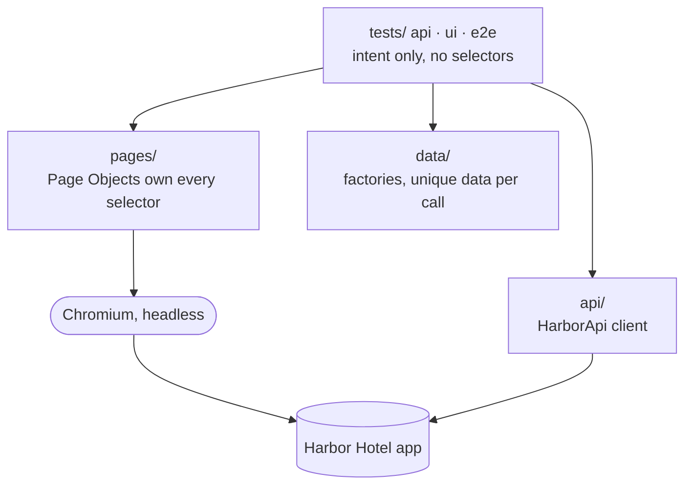

# Playwright POM Framework

**A Playwright + pytest test framework built the way a QA lead would want a team's framework to look: Page Object Model, an API layer, data factories, hybrid API/UI tests, and rules that CI enforces instead of code review.**




The system under test, **Harbor Hotel**, is a small FastAPI app that ships inside this repo (login, rooms CRUD, bookings with a no-overlap rule). The suite starts it automatically, so every run is offline and deterministic, with no dependency on public demo sites that can be slow or down.

## Quick start

```bash
git clone https://github.com/Oren1978/playwright-pom-framework.git
cd playwright-pom-framework
pip install -r requirements.txt
python -m playwright install chromium

pytest                    # full suite, headless, HTML report in reports/report.html
pytest -m smoke           # 5 critical-path tests
pytest -n auto            # parallel
pytest --headed --slowmo 300 -m e2e   # watch the browser
```

## What the suite covers

| Layer | Tests | Examples |
|---|---|---|
| **API** | 24 | CRUD round trip, price boundaries (0, 1, 10000, 10001), duplicate numbers, auth required, five overlap cases for bookings, back-to-back stays allowed |
| **UI** | 9 | Login (valid, wrong credentials, empty form validated before any request), protected route redirect, logout, create room, server errors shown in the form |
| **E2E (hybrid)** | 3 | Create via API, edit and delete in the UI, confirm via API; a room with bookings cannot be deleted from the UI |
| **Framework rules** | 20 | No fixed waits anywhere; no selectors outside `pages/` |

## Architecture



Fixtures in `tests/conftest.py` wire this together: they start the app (or use `--base-url`), create API clients, open logged-in browser sessions and clean up test data.

## Design decisions

| Decision | Why |
|---|---|
| **App bundled with the suite** | Public demo sites were unreachable from my build environment, and in general they are shared, slow and change without notice. A bundled app makes CI deterministic. `--base-url` points the same suite at any deployment of the app. |
| **Selectors live only in `pages/`** | One owner per selector: a UI change is fixed in one file. Enforced by `tests/test_framework_rules.py`, which parses every test file and fails on any `locator()` or `get_by_*()` call. |
| **No fixed waits, enforced twice** | `time.sleep` is banned by ruff (TID251) and `wait_for_timeout` by a rules test. All waits are Playwright web-first assertions that retry until the UI settles. |
| **CI runs the suite against a slow backend** | A matrix job adds 400 ms to every API call. The suite passes unchanged, which shows the tests contain no timing assumptions. |
| **API setup, UI verification** | Hybrid tests create data through the API (fast, reliable) and assert in the UI (what users see), then confirm through the API (what is stored). |
| **Login through the API, except in login tests** | Most UI tests get a session cookie from the API. The login screen is covered once, in its own tests. |
| **Factories, not copied payloads** | Unique room numbers per call mean tests never collide, run in any order and in parallel. CI runs them with `pytest-xdist` and `pytest-randomly`. |
| **Guaranteed cleanup** | Every room a test creates is registered in a fixture and deleted afterwards, with its bookings, even when the test fails. |
| **Traces on failure** | `--tracing retain-on-failure` and screenshots are uploaded as CI artifacts with the HTML report. Open a trace with `playwright show-trace`. |
| **CI pipeline with gates** | `lint` → `smoke` → `full` (normal and slow backend). A broken smoke test stops the pipeline before the long run. |

## Bugs this suite found while it was being built

Writing the tests surfaced three real problems, two in the framework and one in the app. All three are fixed, and each now has a test or a comment that keeps it fixed.

1. **Authenticated page cached after logout (app, security).** After logging out, opening `/admin/rooms` showed the admin page from the browser cache instead of redirecting to login. Fix: `Cache-Control: no-store` on authenticated pages. `test_logout_ends_the_session` catches it: removing the header makes that test fail.
2. **An "anonymous" client that was not anonymous (framework).** Logging in through a shared API context stored the session cookie in it, so the unauthorized-access test passed or failed depending on test order. Fix: tokens are created in a throwaway context.
3. **One test logged everyone out (framework).** The logout test invalidated the session shared by the whole run, so every UI test after it failed. Fix: tests that end a session get their own (`own_session_page`).

## Project layout

```
app/        system under test (FastAPI + static HTML/JS)
pages/      Page Objects: base_page · login_page · rooms_page
api/        HarborApi client
data/       factories for rooms and bookings
support/    settings and the app launcher
tests/      api/ · ui/ · e2e/ · test_framework_rules.py · conftest.py
```

## Honest status

| Area | Status |
|---|---|
| API, UI and hybrid suites, framework rules, CI with gates and slow-backend run | Working, verified locally; CI runs it on every push |
| Browsers | Chromium only; Firefox and WebKit are a one-flag change (`--browser`) but not part of CI yet |
| Visual regression, accessibility checks | Not included |
| Target | The bundled app or another deployment of it; not a generic site tester |

## About

Built by **Oren Cohen**, QA lead with 20+ years in banking, medical devices and SaaS. See also [qa-agent-team](https://github.com/Oren1978/qa-agent-team). [LinkedIn](https://www.linkedin.com/in/oren-cohen-lets-talk/) · [hubsoft.co.il](https://hubsoft.co.il)
